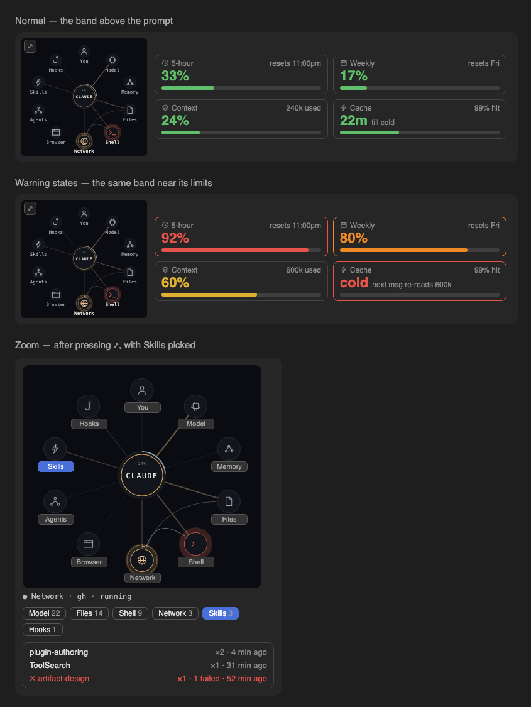

# claude-cockpit

A cockpit for Claude Code: your usage limits and a live map of what Claude is doing, in the band just above the prompt. No extra window to keep open, no tokens spent.



*Preview drawn from the mods' own drawing code. The desktop app's buttons and fonts look slightly different.*

Two mods that work together:

| Mod | What it shows |
| --- | --- |
| **session-hud** | Four tiles: **5-hour** limit, **weekly** limit, **context** used, and **cache** time left. Plus your step progress while Claude works through a task list. |
| **cockpit-map** | A small live map of the work: files, shell, network, browser, agents, skills, hooks, memory and the model light up as they are used. Press **⤢** to enlarge it, then press a station to see what it was used for. |

## Install

Both mods, at the prompt of a Claude Code session:

```
/plugin install session-hud --marketplace I0B0M/claude-cockpit
/plugin install cockpit-map --marketplace I0B0M/claude-cockpit
```

Answer `y` to add the marketplace, then choose a scope. From a shell:

```bash
claude plugin install session-hud --marketplace I0B0M/claude-cockpit
claude plugin install cockpit-map --marketplace I0B0M/claude-cockpit
```

Start a new session afterwards; the band appears above the prompt.

Each mod works on its own. Installed together, the map sits on the left of the band and the tiles on the right.

## Reading the tiles

Every tile turns colour as it fills, and from orange onwards its whole border lights up, so a warning stands out at a glance.

| Tile | Green | Amber | Orange + border | Red + border |
| --- | --- | --- | --- | --- |
| 5-hour, Weekly, Context | under 50% | 50–74% | 75–89% | 90% and up |
| Cache | over 10 min left | | 10 min or less: "reply to keep … warm" | cold: your next message re-reads the whole context |

The corner of each tile says when the limit resets, how many tokens the context holds, or the cache hit rate.

### Option

| Option | Default | Meaning |
| --- | --- | --- |
| `cacheMinutes` | `60` | How long your prompt cache lives: `60` on the 1-hour cache, `5` on the default. Sets when the cache tile counts down to cold. |

```bash
echo '{"cacheMinutes":"5"}' | claude plugin configure session-hud@claude-cockpit --values-stdin
```

## Reading the map

- **Running:** a station glows and grows clock hands while a call runs there.
- **Failed:** a station turns red, with a red dot, until your next message.
- **Context:** the ring around the centre fills as the window does, amber from 70% and red from 90%.
- **Enlarge:** press **⤢** on the small map. The big map opens in a pane beside the chat.
- **Drill down:** press any station's name (on the map, or in the row of buttons under it). The list shows each file, command, host, skill, agent, hook or model used there this session, with how many times, how long ago, and failures in red. Press it again to clear.

`/cockpit-map` also opens the big map.

## Cost and privacy

Neither mod calls a model, uses the network, reads your files or runs programs. The figures come from what Claude Code already reports after each turn. What the map lists is names only (a file's last two path parts, a command's short description, a web host), never contents; details in [plugins/cockpit-map/PRIVACY.md](plugins/cockpit-map/PRIVACY.md).

## Credits

**cockpit-map** is based on [lot-map](https://github.com/alexeyw/lot-map) by Aleksei Volodin (MIT). It adds the compact map in the band, the enlarge button, the clickable stations and the per-station lists; what changed is listed in [plugins/cockpit-map/README.md](plugins/cockpit-map/README.md).

## Developing

```bash
claude plugin validate plugins/session-hud
claude plugin test plugins/session-hud
claude plugin validate plugins/cockpit-map
claude plugin test plugins/cockpit-map
```

## License

MIT. `plugins/cockpit-map` keeps lot-map's own MIT license and copyright alongside.
